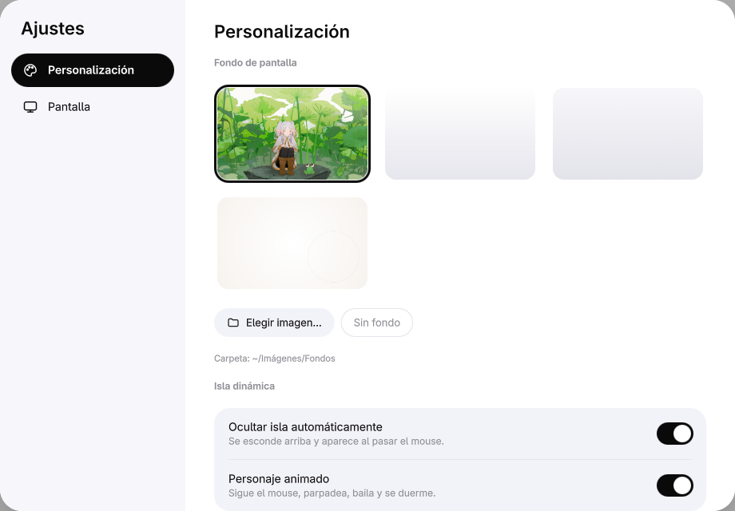
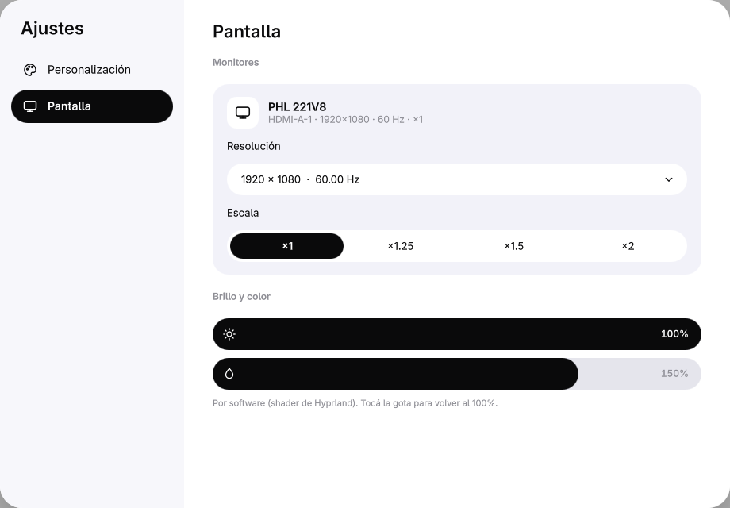
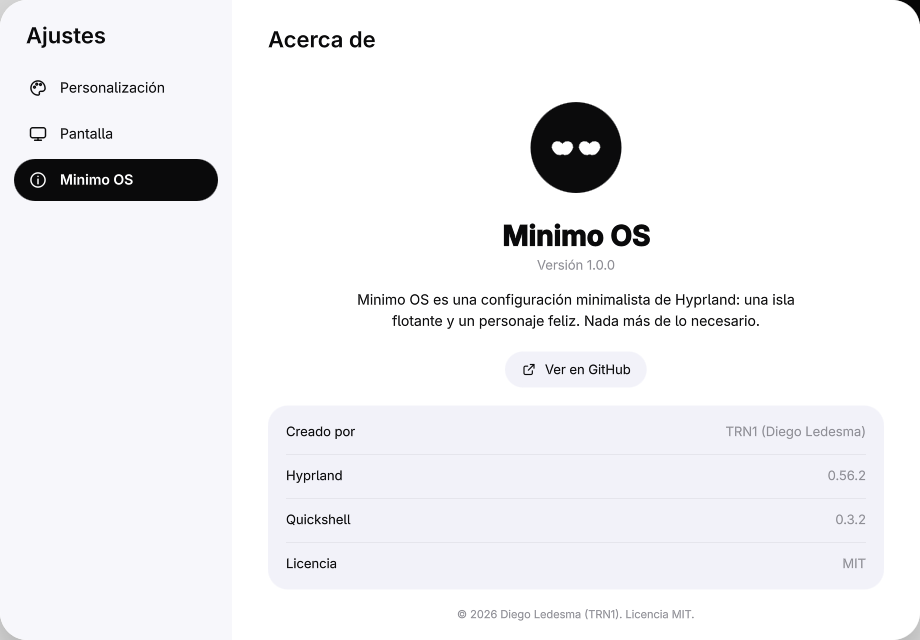

<p align="center">
  
</p>

<h1 align="center">Minimo OS</h1>

<p align="center">Hyprland minimalista: una isla flotante y un personaje feliz. Nada más de lo necesario.</p>

---

## Qué es

Minimo OS es una configuración completa de escritorio para Arch Linux sobre Hyprland, con una
shell propia escrita en Quickshell (QML). Toda la interfaz vive en una sola isla flotante en la
parte superior de la pantalla, acompañada por un pequeño personaje que reacciona a lo que hacés.

## Características

- **Isla dinámica.** Hora, escritorios y estado en una píldora compacta que se oculta sola y aparece al acercar el mouse. Al hacer clic se expande: buscador, música, volumen, brillo, saturación y accesos rápidos.
- **Personaje.** Una esfera negra con ojos que siguen al mouse con proyección esférica. Parpadea, respira, salta, gira, se ríe, guiña, se marea, bosteza, saluda al abrir la isla y baila con la música.
- **Sueño.** Cuando la PC queda inactiva (1, 2 o 5 minutos) el personaje se duerme y aparecen las "z". Despierta al volver a usar el equipo.
- **Lanzador.** `Super + B` abre un buscador de aplicaciones centrado, navegable con el teclado.
- **Grabación de pantalla.** Botón "Grabar" en la isla (wf-recorder, con audio del sistema). Los videos se guardan en `~/Vídeos/Grabaciones`.
- **Reproductor.** Carátula circular que gira como un vinilo mientras suena la música.
- **Ajustes.** Ventana propia con fondo de pantalla, opciones de la isla y del personaje, monitores (resolución, frecuencia y escala con confirmación) y brillo/saturación.

## Capturas

| Personalización | Pantalla | Acerca de |
|---|---|---|
|  |  |  |

## Requisitos

- Arch Linux (usuario normal con `sudo`).
- Hyprland 0.56 o superior (configuración en Lua).
- Paquetes (el instalador los instala): `hyprland xdg-desktop-portal-hyprland hyprpolkitagent quickshell qt6-declarative qt6-svg qt6-wayland pipewire pipewire-pulse wireplumber cava ghostty grim slurp zenity wf-recorder adwaita-fonts git`.
- Opcionales: `fuzzel playerctl wl-clipboard github-cli`.

## Instalación

```bash
git clone https://github.com/Diegolede/minimo-os.git ~/Proyectos/minimo-os
~/Proyectos/minimo-os/install.sh
```

- `--dry-run` muestra cada paso sin cambiar nada.
- `--yes` no hace preguntas.

El instalador es idempotente. Instala los paquetes, respalda `~/.config/hypr` en
`~/.config/hypr.bak-<fecha>`, enlaza la configuración del repositorio (un `git pull` la
actualiza), copia `minimo/monitores.lua` una sola vez (es propio de cada PC), copia los fondos a
`~/Imágenes/Fondos` y habilita el servicio `minimo-shell.service`.

> Mientras el repositorio sea privado, iniciá sesión antes con `gh auth login`.

## Desinstalación

```bash
~/Proyectos/minimo-os/uninstall.sh
```

Desactiva la shell y restaura el último respaldo de `~/.config/hypr`. No borra paquetes ni fondos.

## Atajos

| Atajo | Acción |
|---|---|
| `Super + B` | Lanzador de aplicaciones |
| `Super + Espacio` | fuzzel |
| `Super + T` | Terminal (ghostty) |
| `Super + ,` | Ajustes |
| `Super + X` | Abrir la isla |
| `Super + Shift + R` | Grabar / detener grabación |
| `Imprimir` | Captura de un área |
| `Ctrl + Imprimir` | Captura de pantalla completa |
| `Super + Q` | Cerrar ventana |
| `Super + F` | Maximizar |
| `Super + Shift + F` | Pantalla completa |
| `Super + Ctrl + F` | Maximizar (fijar) |
| `Super + Shift + T` | Flotante / mosaico |
| `Super + W` | Agrupar ventanas |
| `Super + R` | Cambiar división |
| `Super + [` / `]` | Preseleccionar a izquierda / derecha |
| `Super + Inicio` / `Fin` | Primera / última ventana |
| `Super + flechas` o `H J K L` | Mover el foco |
| `Super + Shift + flechas` o `H J K L` | Mover la ventana |
| `Super + Ctrl + ←/→` o `H J K L` | Foco a otro monitor |
| `Super + Shift + Ctrl + flechas` o `H J K L` | Mover ventana a otro monitor |
| `Super + 1…9` | Ir al escritorio |
| `Super + Shift + 1…9` | Mover ventana al escritorio |
| `Super + U` / `I`, `Super + AvPág` / `RePág` | Escritorio siguiente / anterior |
| `Super + Shift + U` / `I`, `Super + Shift + AvPág` / `RePág` | Mover ventana al escritorio siguiente / anterior |
| `Super + Ctrl + ↓/↑` o `U` / `I` | Mover ventana al escritorio siguiente / anterior |
| `Super + rueda` | Cambiar de escritorio |
| `Super + Ctrl + rueda` | Mover ventana de escritorio |
| `Super + clic izquierdo / derecho` | Mover / redimensionar ventana |
| `Super + -` / `=` | Achicar / agrandar en horizontal |
| `Super + Shift + -` / `=` | Achicar / agrandar en vertical |
| `Super + Shift + E` | Cerrar sesión de Hyprland |
| `Super + Shift + P` | Apagar / encender pantallas |
| Teclas de volumen, micrófono y multimedia | Volumen (wpctl) y reproducción (playerctl) |
| Tres dedos en horizontal | Cambiar de escritorio (touchpad) |

## Configuración

Todo lo habitual se cambia desde **Ajustes** (botón en la isla o `Super + ,`):

- **Personalización:** fondo de pantalla, ocultar la isla automáticamente, personaje animado y tiempo para dormir.
- **Pantalla:** resolución, frecuencia y escala por monitor (se revierte en 15 s si no confirmás), brillo y saturación.
- **Minimo OS:** versión e información del sistema.

El estado se guarda en `~/.config/minimo-os/state.json`. La configuración de Hyprland está en
`hypr/` y se puede editar directamente.

Desde la terminal o atajos propios:

```bash
qs -p ~/Proyectos/minimo-os/minimo-shell ipc call launcher toggle
qs -p ~/Proyectos/minimo-os/minimo-shell ipc call settings toggle
qs -p ~/Proyectos/minimo-os/minimo-shell ipc call recorder toggle
qs -p ~/Proyectos/minimo-os/minimo-shell ipc call character list
```

## Estructura del proyecto

```
minimo-os/
├── install.sh / uninstall.sh   instalación y desinstalación
├── hypr/
│   ├── hyprland.lua            punto de entrada de Hyprland
│   ├── minimo.lua              atajos de la shell
│   └── minimo/                 apariencia, entrada, monitores, reglas y atajos
├── minimo-shell/               shell en Quickshell (QML)
│   ├── Island/                 isla dinámica y sus secciones
│   ├── Character/              personaje y reacciones
│   ├── Launcher/               lanzador (Super + B)
│   ├── Settings/               ventana de Ajustes
│   ├── Wallpaper/              fondo de pantalla
│   ├── Common/                 estado compartido, tema y servicios
│   └── assets/                 iconos de línea
├── systemd/                    servicio de usuario de la shell
├── assets/                     icono y fondos por defecto
└── docs/                       capturas
```

## Apoyar Minimo OS

Si te gusta Minimo OS y querés que siga mejorando, podés apoyar el proyecto:
<!-- TODO: reemplazar por el link de donaciones (y completar .github/FUNDING.yml) -->
**[Apoyar Minimo OS](#)** _(link pendiente)_

## Autor

Creado por **TRN1 (Diego Ledesma)**.

## Licencia

[MIT](LICENSE) — © 2026 Diego Ledesma (TRN1).
